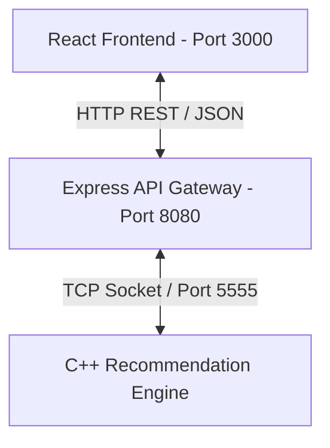
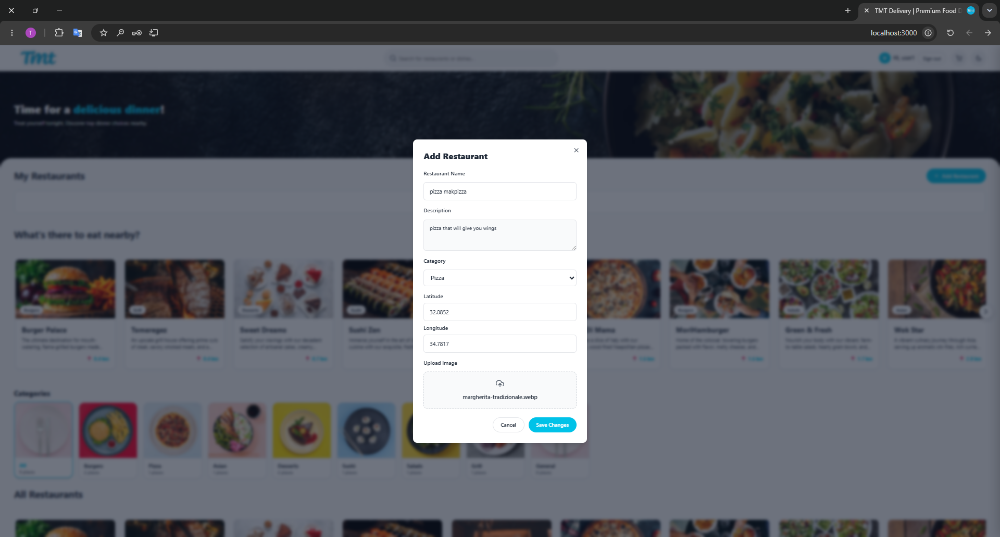
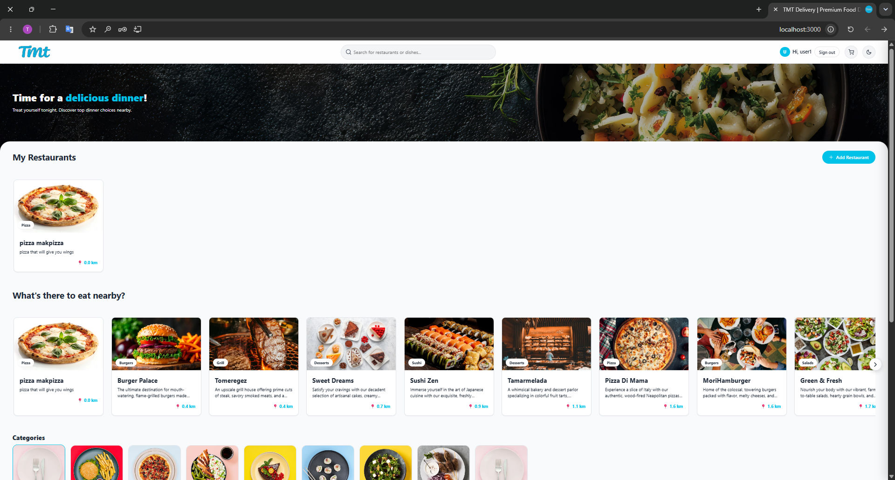
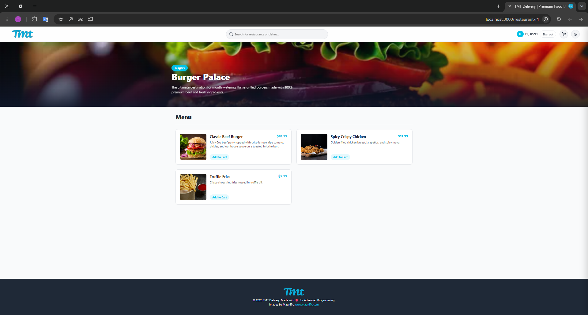
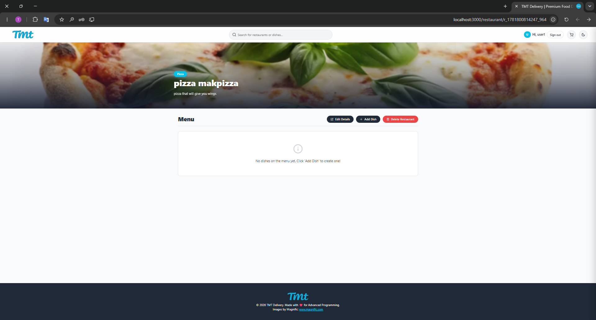
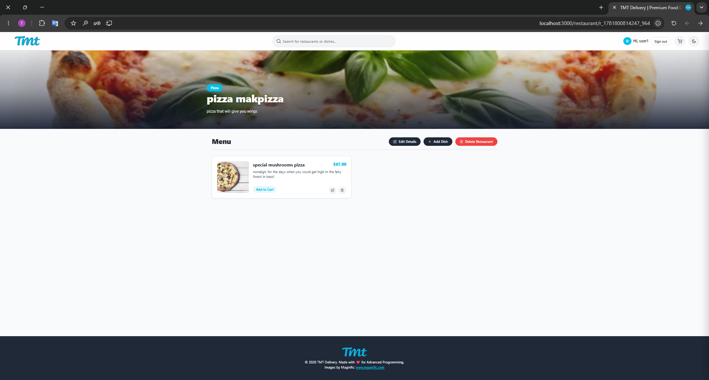
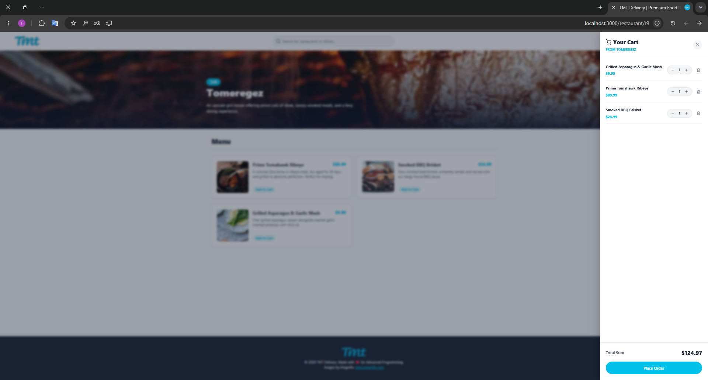
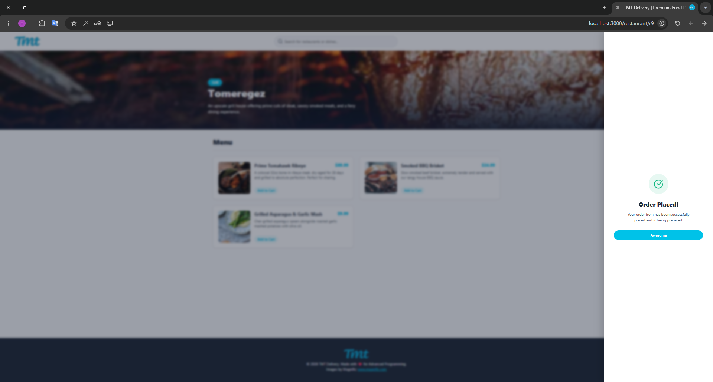
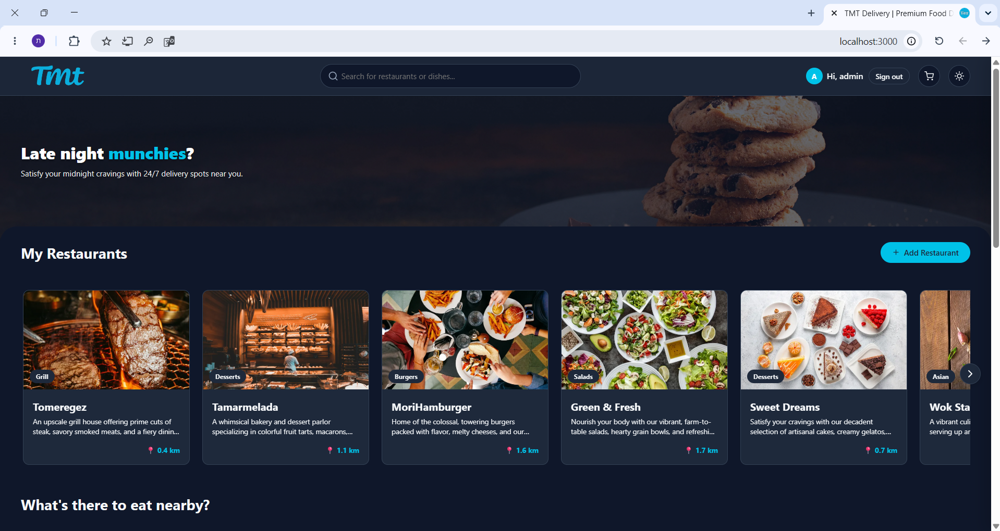

# TMT Delivery - Food Ordering & Recommendation System

TMT Delivery is a complete, containerized food delivery application (similar to Wolt). It integrates a C++ Recommendation Engine, a Node.js Express REST API, and a dynamic React Single Page Application (SPA).

---

## 🚀 How to Run and Build the Project

The entire stack is containerized using Docker and orchestrated with [docker-compose.yml](file:///docker-compose.yml). 

### Prerequisites
Make sure you have [Docker](https://www.docker.com/) and **Docker Compose** installed on your system.

### Running the Application
To build and start all three services (C++ Recommendation Server, Node.js API Server, and React Frontend), run the following command in the project root directory:

```bash
docker compose up --build
```

#### Running Services:
* **React Client Frontend**: Accessible at [http://localhost:3000](http://localhost:3000)
* **Node.js Express API Gateway**: Accessible at [http://localhost:8080](http://localhost:8080)
* **C++ Recommendation Server**: Runs internally on port `5555`

---

### Running C++ Server Unit Tests
The project contains automated unit tests for the C++ Recommendation Server (using GoogleTest). To run these tests within the Docker environment, execute:

```bash
docker compose --profile test run tests
```

---

## 🏗️ How the Project is Built (Architecture)

The application follows a highly modular, decoupled architecture distributed across three layers:



### Component Breakdown
1. **Frontend Client ([react-client/](file:///react-client))**:
   - Built using **React 19** and **React Router DOM 7**.
   - Leverages React Context for global state management (such as Theme and Authentication).
   - Custom styling with vanilla CSS supporting a fully responsive layout and seamless Dark/Light Mode.
2. **REST API Server ([api/](file:///api))**:
   - Built with **Node.js** and **Express**.
   - Serves as the central API gateway handling CRUD requests for users, restaurants, products, and orders.
   - Implements an MVC pattern, persisting resources in-memory using [InMemoryDB.js](file:///api/src/models/InMemoryDB.js).
   - Functions as a client to the recommendation engine, sending tracking events (e.g., when a user views a product) over a standard TCP Socket on port `5555`.
3. **Recommendation Engine ([cpp/](file:///cpp))**:
   - High-performance server written in **C++** and compiled with **CMake**.
   - Tracks user viewing behavior and utilizes collaborative filtering and item-to-item recommendations to recommend alternative restaurants.
   - Listens for TCP connections inside the container network.

### Key Implementation Details
* **In-Memory Data Store**: The API server persists data in volatile structures. Data is reset upon server restart.
* **Authentication**: Secured using custom header verification. The React application sends commands using JWT-based headers to authenticate requests.
* **Distance Calculation**: The application uses user and restaurant coordinates (Latitude/Longitude) to dynamically compute and render distances in kilometers.
* **Theme Switching**: A unified [ThemeContext.jsx](file:///react-client/src/contexts/ThemeContext.js) listens for toggle triggers, modifying the CSS variables on the document body (`body.dark-mode`). The user's preferred theme is saved in `localStorage` per user ID, ensuring it persists across sessions.

---

## 📸 Interface and Walkthrough 

Below is an overview of the screenshots from the `runScreenShot/` directory, illustrating key application views and workflows:

### Registration Screen 

* **Page Route**: `/register`
* Allows new users to sign up. Features field validations (e.g., minimum 8 character password with letters and special characters), username check, display name, account type selection, optional profile picture selection (previewing local images), and location coordinate inputs (Latitude and Longitude) used for nearby restaurant distance calculations.

---

### Add Restaurant Modal 

*  **Usage**: A modal interface visible to authorized owners. It prompts for the Restaurant Name, Description, Category (dropdown selection), Latitude/Longitude coordinates, and custom image file upload. The background page is blurred out for user focus.

---

### Homepage Overview 

* **Page Route**: `/`
* Shows the primary dashboard after login (before login only categories are shown).
  - **Dynamic Distance**: Highlights "pizza makpizza" (recently added) at `0.0 km` distance since it aligns with the user's coordinate location. Other restaurants are listed with dynamically calculated distances (e.g., `0.4 km`, `0.7 km`).
  - **Sections**: Groups restaurants into "My Restaurants", "What's there to eat nearby?", "Categories"- and display by the selected category.
  - **Theme Toggle**: The moon icon in the upper right header toggles between Light and Dark mode.

---

### Restaurant Details & Menu 

* **Page Route**: `/restaurant/:id` (e.g., `/restaurant/r1` for Burger Palace)
* Displays a hero banner, category badge, and description of the restaurant. Displays menu cards featuring product names, pricing, detailed descriptions, and quick "Add to Cart" actions.

---

### Restaurant View for Owners 

* Shows the newly created restaurant details page before any dishes are added. Since the logged-in user is the owner, special management controls appear below the description banner: **Edit Details**, **+ Add Dish**, and **Delete Restaurant**.

---

### Adding Menu Items 

* The custom modal allowing owners to add a new dish to their menu by defining the name, price in USD ($), description, and uploading a product image (defult messege-image instead of image if not uploaded).

---

### Managed Menu View 

* Renders the updated menu containing the added dish. In addition to "Add to Cart", the owner has quick edit and delete options for the item directly on the card.

---

### Product Details Dialog 

* Clicking a menu card opens a modal presenting a large view of the dish, its pricing, detailed ingredients, and a direct checkout action button ("Add to Order").

---

### Interactive Shopping Cart Drawer 

* A slide-out right drawer showing current cart contents. Users can edit item quantities (increment/decrement), delete items, see the running subtotal dynamically calculated, and complete checkout.

---

### Order Confirmation 

* Upon clicking "Place Order", the cart updates in real-time to show a success state with a checkmark confirming the order has been submitted.

---

### User Profile & History 

* **Page Route**: `/profile`
* **Profile Details**: Shows user account details. Includes:
  - **Order History**: Lists previously placed orders with order date, detailed item listing with quantities, total price, and real-time status (e.g., "Processing").
  - **My Restaurants**: A section displaying all restaurants registered by this user.

---

### 🌓 Dark Mode Toggle
The application includes a system-wide Dark Mode.
* **How it works**: In the navigation bar, a theme toggle button switches between Light and Dark mode.
* **Persistent Preference**: Toggling the theme writes the preference (`theme_<userID>: "dark" | "light"`) into the browser's `localStorage` linked to the specific authenticated user.
* **Styling**: Swapping is handled globally in [index.css](./react-client/src/index.css) by overriding background and text color CSS variables under the `body.dark-mode` selector. This guarantees smooth, low-latency theme transitions without requiring full page re-renders.
  

