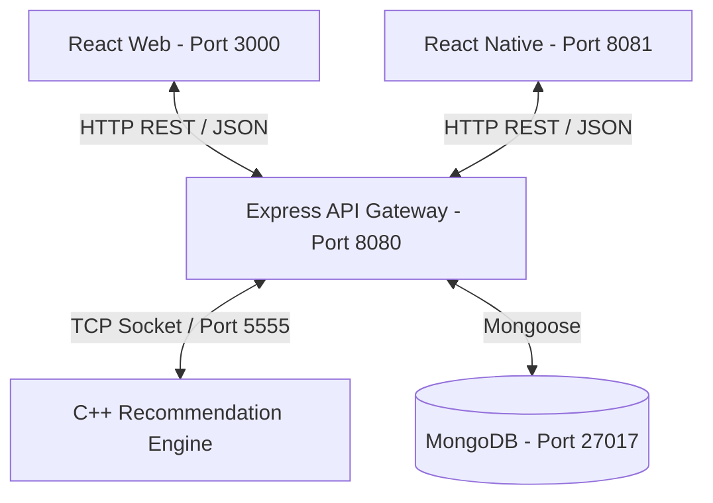

<p align="center">
  
</p>

# TMT Delivery
**A Cross-Platform Food Ordering & Recommendation System (Inspired by Wolt)**

TMT Delivery is a complete, containerized ecosystem integrating a high-performance **C++ Recommendation Engine**, a robust **Node.js Express REST API**, a dynamic **React Web Application**, and a **React Native (Expo) Mobile Application**.

---

## 🚀 How to Run and Build the Project

The entire stack is containerized using Docker and orchestrated with [`docker-compose.yml`](./docker-compose.yml). 

### Prerequisites
Make sure you have [Docker](https://www.docker.com/) and **Docker Compose** installed on your system.

### 1. Build and Run Backend & Web Clients
To raise the MongoDB database, the C++ recommendation engine, the Node.js Express server, and the React Web Client, open a terminal in the root project directory and run:

```bash
docker compose up --build
```
*(Note: Keep this terminal open and running!)*

#### Running Services:
* **React Web Frontend**: Accessible locally at `http://localhost:3000`
* **Node.js Express REST API**: Accessible locally at `http://localhost:8080`
* **MongoDB Instance**: Accessible at `mongodb://localhost:27017`
* **C++ Recommendation Engine**: Runs on port `5555` inside the container network.

### 2. Run the React Native Mobile Client (Expo)
Open a **new, separate terminal** so the backend remains running. You have two options to launch the mobile app:

**Option A: Via Docker Profile**
```bash
docker compose --profile mobile up --build
```

**Option B: Locally (Recommended for Emulators)**
If you want to run the app on an Android Emulator or iOS Simulator, or via the Expo Go app on your physical phone, run it locally:
```bash
cd mobile-client
npm install
npm start
```
*Once the Metro Bundler starts:*
- **Emulators**: Press `a` in the terminal to open the Android Emulator, or `i` for the iOS Simulator.
- **Physical Device**: Download the **Expo Go** app (Note: requires **version 56**) on your smartphone and scan the QR code displayed in the terminal to run the app on your own device.

---

### Running C++ Server Unit Tests
The project contains automated unit tests for the C++ Recommendation Server (using GoogleTest). To run these tests within the Docker environment, execute:

```bash
docker compose --profile test run tests
```

---

## 📸 Interface and Walkthrough 
For detailed walkthroughs and screenshots of both the Web Application and the Mobile Application, please refer to the [Wiki Documentation](./wiki/Home.md).

---

## 🏗️ How the Project is Built (Architecture)

The application follows a highly modular, decoupled architecture distributed across three layers:



### Component Breakdown
1. **Web Frontend Client ([react-client/](./react-client))**:
   - Built using **React 19** and **React Router DOM 7**.
   - Custom styling with vanilla CSS supporting a fully responsive layout and seamless Dark/Light Mode.
2. **Mobile Client ([mobile-client/](./mobile-client))**:
   - Built with **React Native** and **Expo**.
   - Cross-platform support (iOS/Android) using NativeWind and Expo Router.
3. **REST API Server ([api/](./api))**:
   - Built with **Node.js** and **Express**.
   - Serves as the central API gateway handling CRUD requests.
   - Implements an MVC pattern, persisting resources in **MongoDB** using Mongoose.
   - Communicates with the recommendation engine over TCP.
4. **Recommendation Engine ([cpp/](./cpp))**:
   - High-performance server written in **C++** and compiled with **CMake**.
   - Tracks user viewing behavior and utilizes collaborative filtering to recommend products.
5. **Database Layer**:
   - **MongoDB** container running on port `27017` to securely store all persistent data.

### Key Implementation Details
* **Database Persistence**: The API server persists data using MongoDB, replacing the previous volatile in-memory structure. Data persists reliably across container restarts via Docker volumes.
* **Authentication**: Secured using custom header verification. The React application sends commands using JWT-based headers to authenticate requests.
* **Distance Calculation**: The application uses user and restaurant coordinates (Latitude/Longitude) to dynamically compute and render distances in kilometers.
* **Theme Switching**: A unified [`ThemeContext.jsx`](./react-client/src/contexts/ThemeContext.jsx) listens for toggle triggers, modifying the CSS variables on the document body (`body.dark-mode`). The user's preferred theme is saved in `localStorage` per user ID, ensuring it persists across sessions.


## 🛠️ Agile Development & Version Control

The project was managed using strict Agile methodologies to simulate a real-world development environment:
* **Jira & Sprints**: We utilized Jira to plan our development cycles, working in defined Sprints. Features were meticulously broken down into Epics, User Stories, and Tasks.
* **Git & GitHub**: Version control was handled through Git. We adhered to a strict **Feature Branch** workflow to ensure the `main` branch remained stable at all times.
* **Code Reviews**: All features were merged into the main branch exclusively via Pull Requests (PRs), requiring code reviews and approvals from teammates before integration.

---

## 👥 Work Stages (Course Assignments)

This project was developed incrementally over the course of the semester, divided into 5 major assignments:

* **Phase 1 (C++ Recommendation Engine)**: Built the core algorithmic logic in C++. Implemented a Collaborative Filtering system as a CLI application that stores user viewing histories and calculates product recommendations based on user similarity.
* **Phase 2 (TCP Client-Server Architecture)**: Upgraded the C++ application to run as a dedicated TCP Server. Implemented a Python client to interact with the server over sockets, handling requests asynchronously.
* **Phase 3 (Node.js REST API & MongoDB)**: Developed the central backend using Node.js and Express. Transitioned to persistent data storage with MongoDB (Mongoose). This API handles all CRUD operations and communicates via TCP with the C++ Recommendation Server.
* **Phase 4 (React Web Application)**: Built the dynamic Single Page Application (SPA) using React 19 and vanilla CSS. Implemented a full user journey (Registration, Browsing, Cart, Checkout) inspired by Wolt's UI, integrating seamlessly with the Node.js API.
* **Phase 5 (React Native Mobile App)**: Expanded the ecosystem to mobile using React Native and Expo. Replicated the core web functionalities into a native cross-platform environment (iOS/Android) relying on the exact same backend infrastructure.

