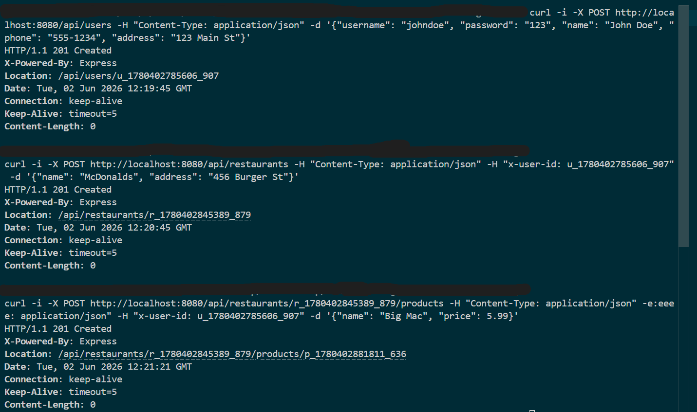

# Advanced-Programming


# TMTproject - Product Recommendation System

## About The Application
This is a CLI-based Product Recommendation System written in C++. 
The application allows users to input viewing histories for various users and request product recommendations. It utilizes a collaborative filtering approach: when a user expresses interest in a specific product, the system finds other users with similar tastes who also viewed that product, and recommends additional products they watched, ranked by similarity weights.



## How to Run

The application is containerized using Docker. 

### Build the Image
To build the Docker image, run the following command in the root directory of the project:

build command:
```bash
docker build -t recommender-image .
```
run command:
```bash
docker run -it --rm -v "${PWD}/data:/usr/src/mytest/data" recommender-image
```
### available commands:

The application supports the following commands:  

add [userid] [productid 1] [productid 2] ...: Associates products with a user. Data is automatically saved to the data/ directory.

recommend [userid] [productid]: Provides up to 10 product recommendations for the given user and product context.

help: Displays the help menu


## Application Example:
Below is a demonstration of adding user data and requesting a recommendation:
```bash
> add 1 100 101 102 103
> add 2 101 102 104 105 106
> add 3 100 104 105 107 108
> recommend 1 104
105 106 107 108
```

## Visual Representation
Design Notes:
Persistence: All data entered via the add command is stored in data/data.txt to ensure continuity between runs.  

        Architecture: The project uses an interface-based design (ICommand, IDataRepository, etc.) to allow for easy swapping of input/output sources and storage methods in future exercises
