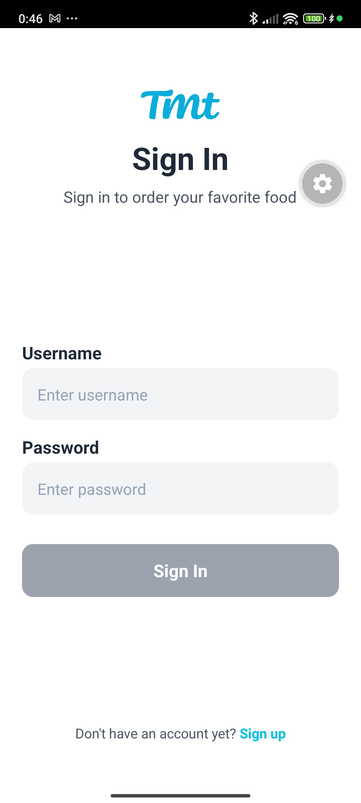
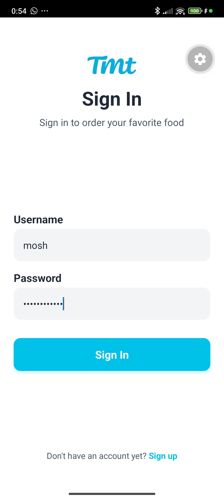
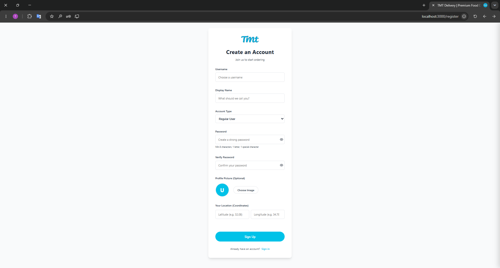
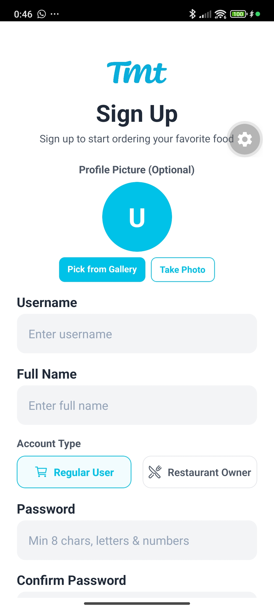
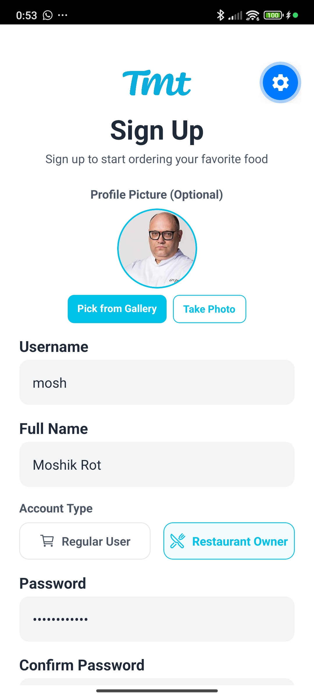
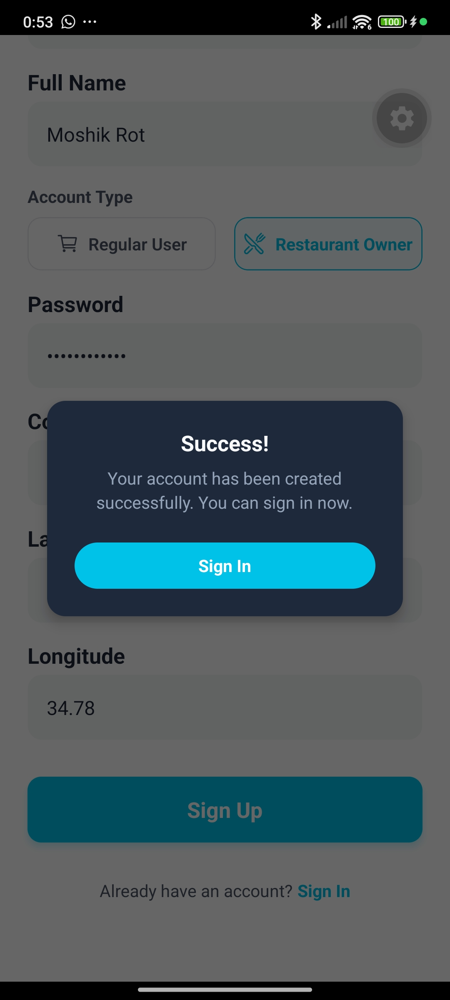
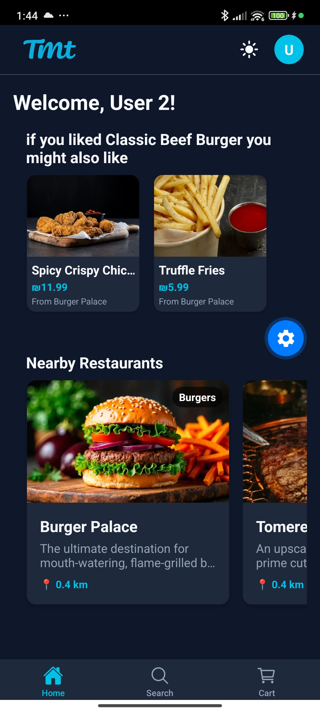

# Authentication & User Management

The application features a secure signup and sign-in module with robust validation rules, account type roles, and profile picture customization.

---

## 🔐 Sign In & Authentication Flow

### Login Screen

When users open the app, they are presented with the **Login Screen**. Form controls validate that fields are filled out. Tapping "Sign up" redirects to the registration form.

**Web Client**:
 *(MISSING: Add screenshot here)*

**Mobile Client**:
 

---

## 📝 User Registration & Input Validation

The registration module allows creating either a **Regular User** (Customer) or a **Restaurant Owner**. It enforces real-time input validations:

* **Username & Full Name**: Mandatory fields, cannot be empty.
* **Account Type (Roles)**: Interactive cards to choose between `Customer` and `Owner` roles.
* **Password Validation**: Enforced via regex to be **at least 8 characters long**, containing **letters, numbers, and at least one special character**.
* **Coordinates (Latitude & Longitude)**: Must be valid floating-point numbers. These coordinates are used for dynamic distance calculations to nearby restaurants.
* **Profile Image Upload**: Integrated with Expo Image Picker, allowing the user to select an existing image from their device gallery or capture a photo using their camera.

### 1. Registering as a Restaurant Owner (or Customer)

Filling out registration details with the role card set to **Restaurant Owner** (Owner) or **Customer**. Valid fields remove the real-time red warning messages.

**Web Client**:

**Mobile Client**:
 

### 2. Successful Registration

Upon successful API registration, a custom success modal is shown, prompting the user to navigate back to the Sign In screen to log in.

**Web Client**:
 *(MISSING: Add screenshot here)*

**Mobile Client**:

---

## 👤 Multi-User Switching

The application supports multiple users and tracks their specific activity histories (logged views and orders) for collaborative recommendation logic.

### 1. Logging Out (User 1)

Tapping the logout button under the profile screen signs the user out, clearing the session headers and local storage, and returning the user to the login screen.

**Web Client**:
 *(MISSING: Add screenshot here)*

**Mobile Client**:

### 2. Logging In as User 2

Signing in as `user2` to inspect the collaborative recommendations based on the previous user's order actions.

**Web Client**:
 *(MISSING: Add screenshot here)*

**Mobile Client**:

