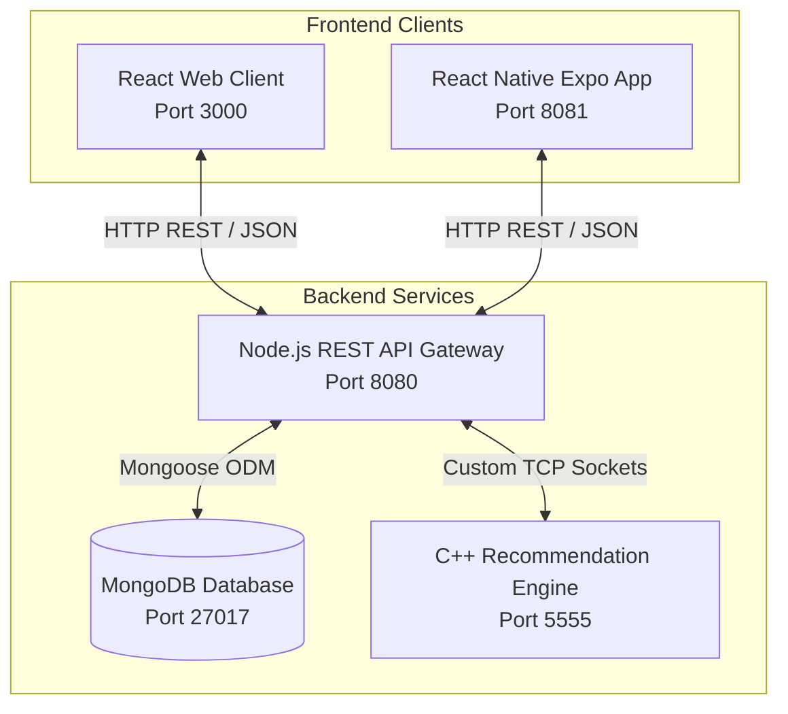

# TMT Delivery - Wiki Documentation

Welcome to the **TMT Delivery** system documentation. This Wiki demonstrates the end-to-end capabilities, implementation details, and execution flows of our containerized food delivery application (inspired by Wolt).

The system integrates a C++ Collaborative Filtering Recommendation Server, a Node.js REST API Gateway with MongoDB persistence, a React Web Client, and a React Native Mobile Client.

---

## 🏗️ System Architecture

Our application is built on a highly modular, containerized multi-tier architecture:

---

## 📖 Table of Contents

Navigate through the wiki pages below to explore the project setup and chronological screenshot walkthroughs:

1. **[Environment Setup](./Environment-Setup.md)**: How to compile, build, and run the entire environment using Docker Compose.
2. **[Authentication & User Roles](./Authentication.md)**: Registration and login flows, role management (Owners vs. Customers), and form validations.
3. **[Restaurant & Product Management](./Restaurant-and-Product-Management.md)**: Creating, editing, and deleting restaurants and menu items (products) by restaurant owners.
4. **[Ordering & Checkout](./Ordering-and-Checkout.md)**: Customer checkout process, shopping cart management, categories, and light/dark theme switching.
5. **[Search & Navigation](./Search-and-Navigation.md)**: Product searches and the main search/category banners.
6. **[C++ Recommendation Engine](./Recommendation-Engine.md)**: Details on the Collaborative Filtering recommendation algorithm, TCP communication protocols, and a walkthrough of the similarity recommendation trace.
