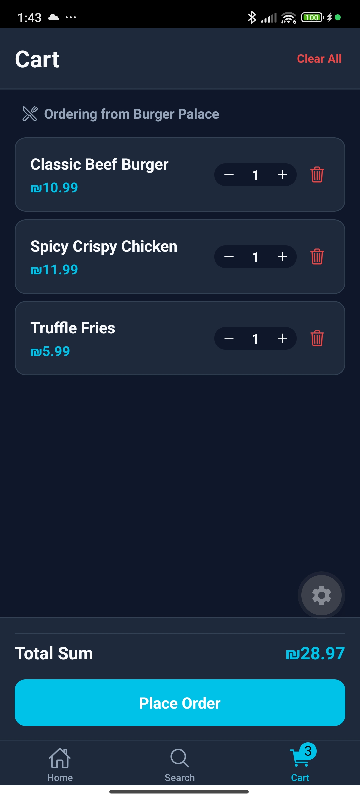
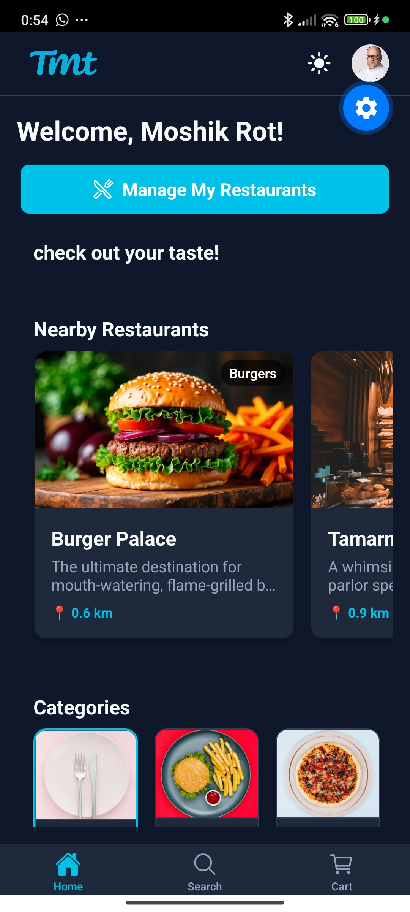

# Ordering, Cart & Checkout Process

This section covers the end-to-end customer purchasing journey, shopping cart drawer management, category filter interactions, theme customization, and checking the order history page.

---

## 🛒 Shopping Cart & Placing Orders

Customers can add products to their carts from a single restaurant at a time. If a user attempts to add a product from a different restaurant, a prompt will ask them if they want to clear their current cart before adding the new item. The shopping cart calculates totals, allows item quantity adjustments, and handles checkout processing.

### 1. Initiating an Order (Product Details)

A user browses a menu, clicks on a dish (e.g. Beef Burger) to open the details modal, and clicks **Add to Order** to add it to the cart.

**Web Client**:

**Mobile Client**:

### 2. Multi-Item Cart Drawer

Multiple items are added to the cart (French Fries, Milkshake, Beef Burger). The Cart Screen (or side drawer) aggregates all items, showing details, subtotal calculations, allows editing item quantities (increment/decrement), deleting items, and displays a clear **Checkout** call-to-action button.

**Web Client**:

**Mobile Client**:

### 3. Order Completion & Success

Tapping "Checkout" sends an order payload to the backend REST API, storing the order details in MongoDB. A successful response displays a confirmation message, and the cart is cleared/updates in real-time.

**Web Client**:

**Mobile Client**:

---

## 🌓 Categories & Styling Themes

The app is inspired by Wolt's visual layout and offers a category filtering banner and full Light/Dark mode transitions.

### 1. Category Banner (Burgers, Pizza, Asian, Desserts)
*(MISSING: Add Category Banner screenshot here)*

* Located at the top of the Home page. Selecting a category icon instantly filters the displayed restaurants list.

### 2. Light / Dark Mode UI

Swapping between Light and Dark mode using the sun/moon icon in the header. The system updates styling tokens instantly and saves the user preference in the browser/device local storage.

**Web Client (Dark Mode)**:

**Mobile Client (Dark Mode)**:

---

## 📜 User Profile & Order History

Each user has a profile page showing details, coordinates, and their complete order history.

### User Profile Page

Shows the logged-in user profile page. Under the **Order History** section, we can see the recently placed orders, including the order details from Burger Palace (3 specific products: Beef Burger, French Fries, Milkshake) showing as processing/completed. For owners, on web, a "My Restaurants" section displays all registered restaurants.

**Web Client**:

**Mobile Client**:

