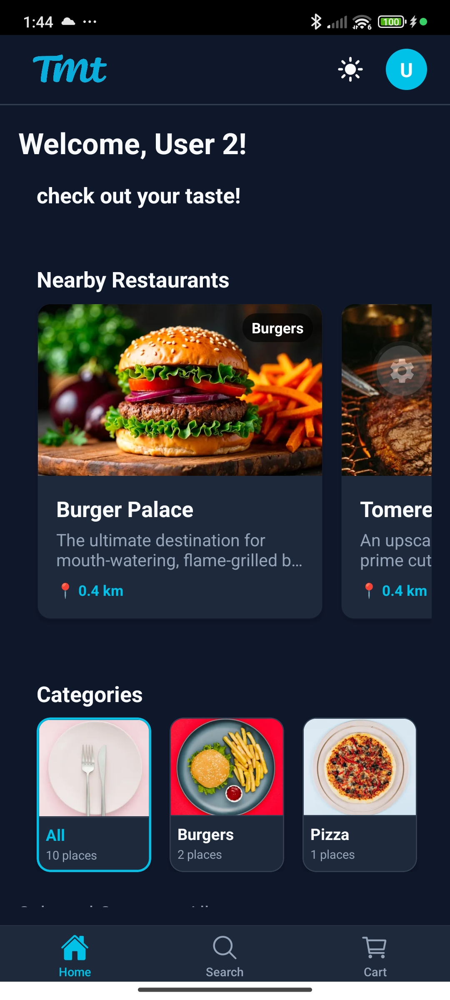
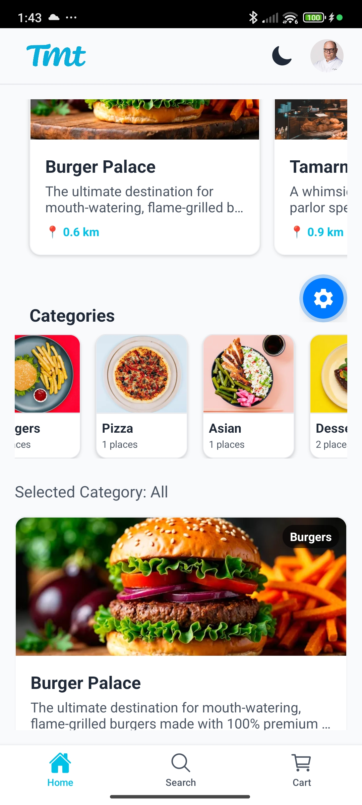

# Restaurant & Product Management

Users registered with the **Restaurant Owner** role have full CRUD (Create, Read, Update, Delete) permissions over their restaurants and corresponding menu products.

---

## 🏬 Owner Restaurant Dashboard

When logged in as an Owner, the homepage displays a dedicated **My Restaurants** section where the owner can manage all of their establishments.

### 1. Initial State (No Restaurants)

* Shows the owner's homepage. Since no restaurants are registered yet, the "My Restaurants" section shows a prompt to add a new establishment.

### 2. Creating a Restaurant

* Clicking "Add Restaurant" opens a modal form. The owner specifies the Restaurant Name (e.g., Burger Palace), Description, Category (selection dropdown), Location coordinates (Latitude and Longitude), and Cover Image (loaded from device library).

### 3. New Restaurant Overview (Empty Menu)

* Shows the newly created restaurant details page. Because the current user is the verified owner, additional management controls appear on the screen: **Add Product**, **Edit Restaurant** (pencil icon), and **Delete Restaurant** (trash icon).

---

## 🍔 Menu Product Management

Owners can construct and customize their menu lists by adding separate dishes (products) to their restaurant profiles.

### 1. Adding a Dish

* Clicking the "Add Product" button triggers a modal where the owner defines the item's details: Product Name (e.g., Beef Burger), Price (in shekels, e.g. ₪50), Description, and Product image (picked from the device gallery).

### 2. Menu Populated

* The newly added dish immediately appears on the restaurant's menu list.

### 3. Populated Restaurant Menu

* Multiple products are added (e.g., French Fries, Milkshake, Beef Burger) to complete the menu. Owners can tap any menu item card to edit its description, adjust pricing, or delete the item completely.
