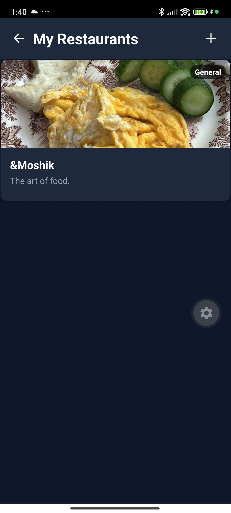
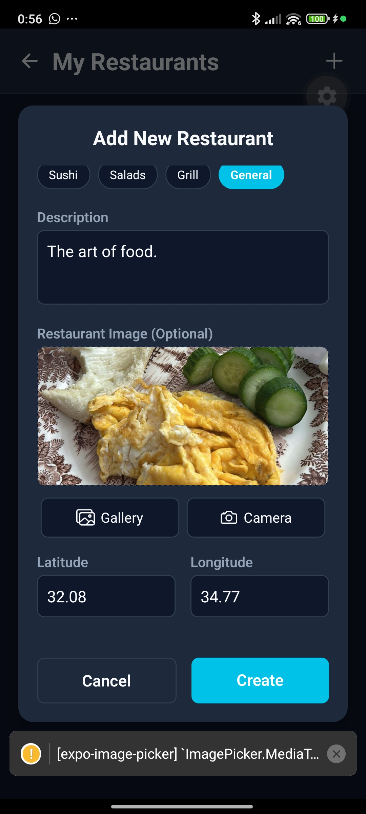
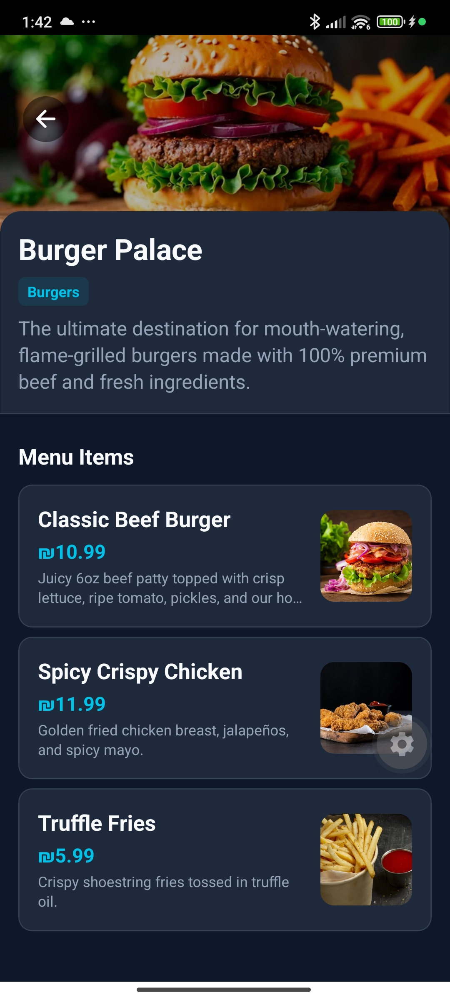

# Restaurant & Product Management

Users registered with the **Restaurant Owner** role have full CRUD (Create, Read, Update, Delete) permissions over their restaurants and corresponding menu products.

---

## 🏬 Owner Restaurant Dashboard

When logged in as an Owner, the homepage displays a dedicated **My Restaurants** section where the owner can manage all of their establishments.

### 1. Initial State (No Restaurants)

Shows the owner's homepage. Since no restaurants are registered yet, the "My Restaurants" section shows a prompt to add a new establishment.

**Web Client**:
 *(MISSING: Add screenshot here)*

**Mobile Client**:

### 2. Owner Dashboard (Populated)

Once a restaurant is added, it appears as a tile under the "My Restaurants" section.

**Web Client**:
*(MISSING: Add populated dashboard screenshot here)*

**Mobile Client**:

### 3. Creating a Restaurant

Clicking "Add Restaurant" opens a modal form. The owner specifies the Restaurant Name (e.g., Burger Palace), Description, Category (selection dropdown), Location coordinates (Latitude and Longitude), and Cover Image (loaded from device library).

**Web Client**:

**Mobile Client**:
 

### 4. New Restaurant Overview (Empty Menu)

Shows the newly created restaurant details page before any dishes are added. Because the current user is the verified owner, additional management controls appear on the screen: **Add Product**, **Edit Restaurant**, and **Delete Restaurant**.

**Web Client**:

**Mobile Client**:
*(MISSING: Add Restaurant Details Empty screenshot here)*

### 5. Editing and Deleting a Restaurant (CRUD)

Owners can update the restaurant details or remove the restaurant entirely from the system.

**Web Client**:
 *(MISSING: Add Edit/Delete screenshot here)*

**Mobile Client**:
 *(MISSING: Add Edit/Delete screenshot here)*

---

## 🍔 Menu Product Management

Owners can construct and customize their menu lists by adding separate dishes (products) to their restaurant profiles.

### 1. Adding a Dish

Clicking the "Add Product" button triggers a modal where the owner defines the item's details: Product Name (e.g., Beef Burger), Price (in shekels or USD), Description, and Product image (picked from the device gallery or default placeholder).

**Web Client**:

**Mobile Client**:

### 2. Menu Populated

The newly added dish immediately appears on the restaurant's menu list.

**Web Client**:

**Mobile Client**:

### 3. Populated Restaurant Menu (Customer View vs Owner View)

Multiple products are added (e.g., French Fries, Milkshake, Beef Burger) to complete the menu. Owners can tap any menu item card to edit its description, adjust pricing, or delete the item completely. Customers will only see the "Add to Cart" action.

**Web Client**:

**Mobile Client**:

### 4. Editing and Deleting a Dish (CRUD)

Owners can adjust pricing, update the image/description, or remove the dish from the menu.

**Web Client**:
 *(MISSING: Add Edit/Delete screenshot here)*

**Mobile Client**:
 *(MISSING: Add Edit/Delete screenshot here)*
