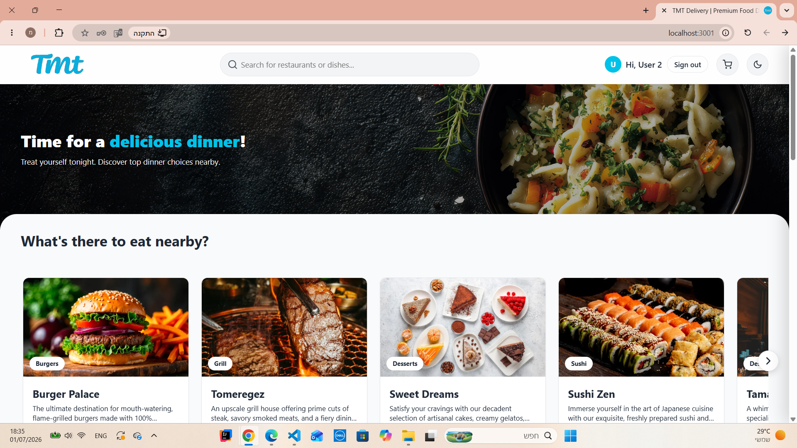
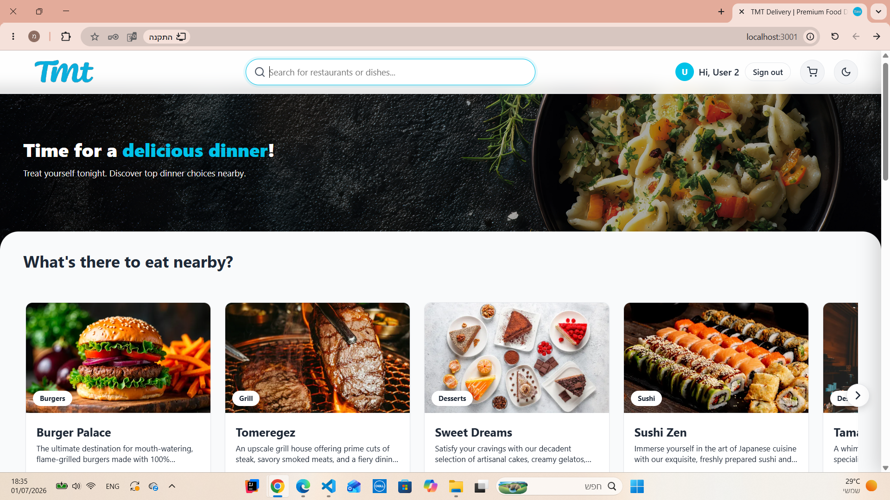
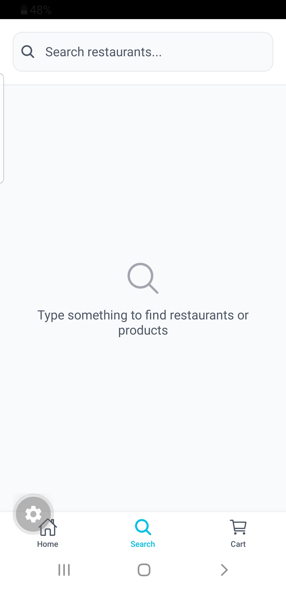
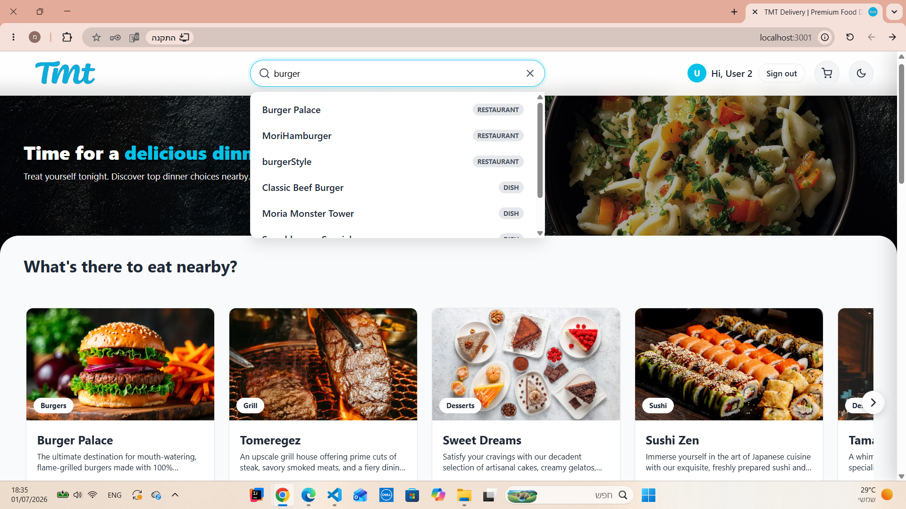
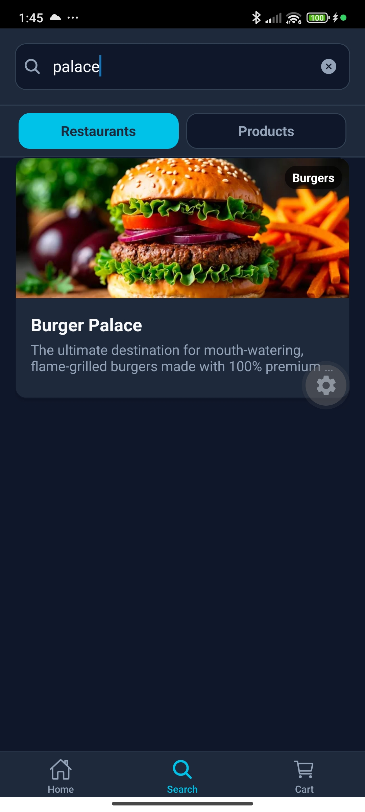
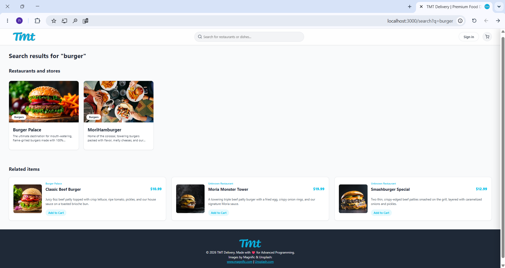
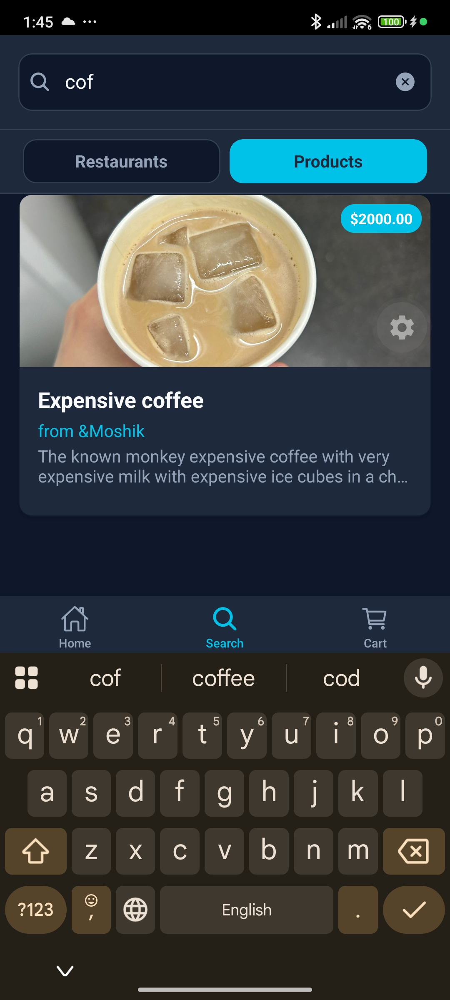

# Search & Navigation

The application provides a flexible search system that scans the MongoDB database for matches in both restaurant information (names/descriptions) and individual product items. It also features a dynamic homepage to help users discover nearby restaurants and categories.

---

## 🏠 Homepage Overview

The primary dashboard after login displays dynamic sections tailored to the user.

- **Dynamic Distance**: Highlights restaurants at calculated distances (e.g., `0.0 km`, `0.4 km`) based on alignment with the user's coordinate location.
- **Sections**: Groups restaurants into "My Restaurants" (for owners), "Recommended for you", "What's there to eat nearby?", and "Categories".

**Web Client**:

**Mobile Client**:
 

---

## 🔍 Search Bar & Search Page Flow

The search input is located prominently in the navigation structure of the homepage.

### 1. Navigating to the Search Input

Clicking the search bar or search tab in the navigation bar takes the user to the search input screen.

**Web Client**:

**Mobile Client**:

### 2. Typing a Query

The user types a query (e.g., "burger") into the search banner. The input triggers search handlers in the frontend.

**Web Client**:

**Mobile Client**:

### 3. Search Results (Matching Restaurants & Products)

The API queries MongoDB, searching both the Restaurants collection and Products collection for name or description matches containing the search term. The Search Screen displays matching restaurants as well as individual dishes matching the query, allowing users to tap and open restaurants and products directly from the search results.

**Web Client**:

**Mobile Client**:

